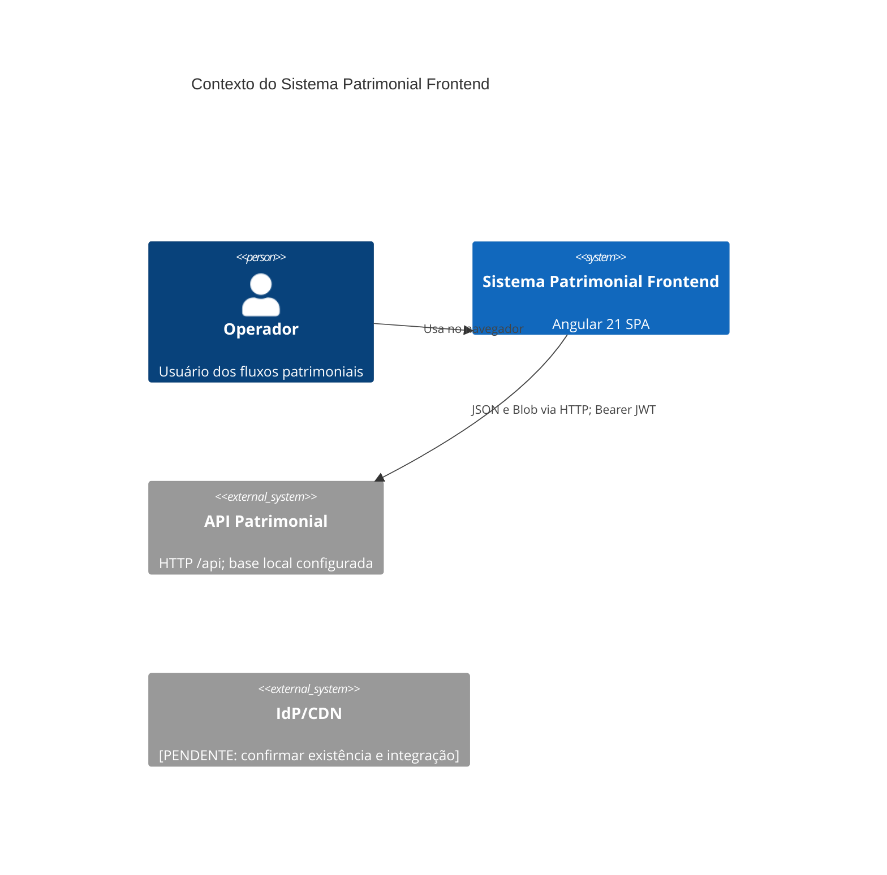
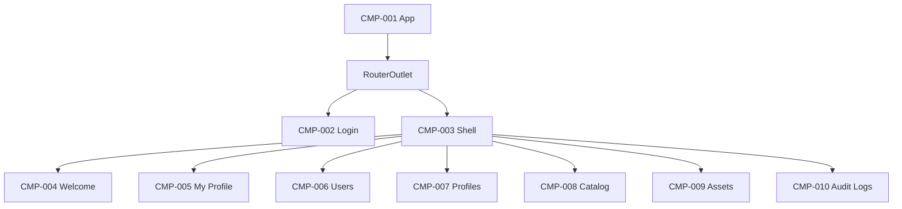
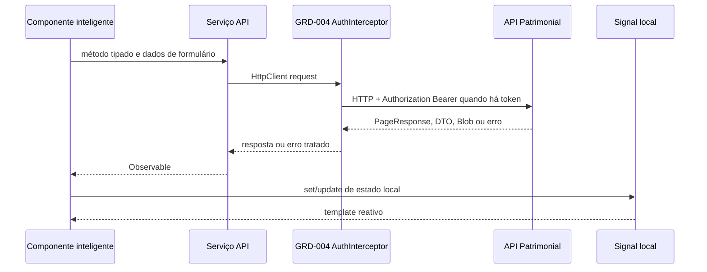
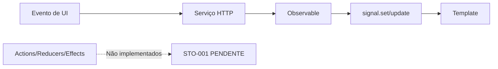
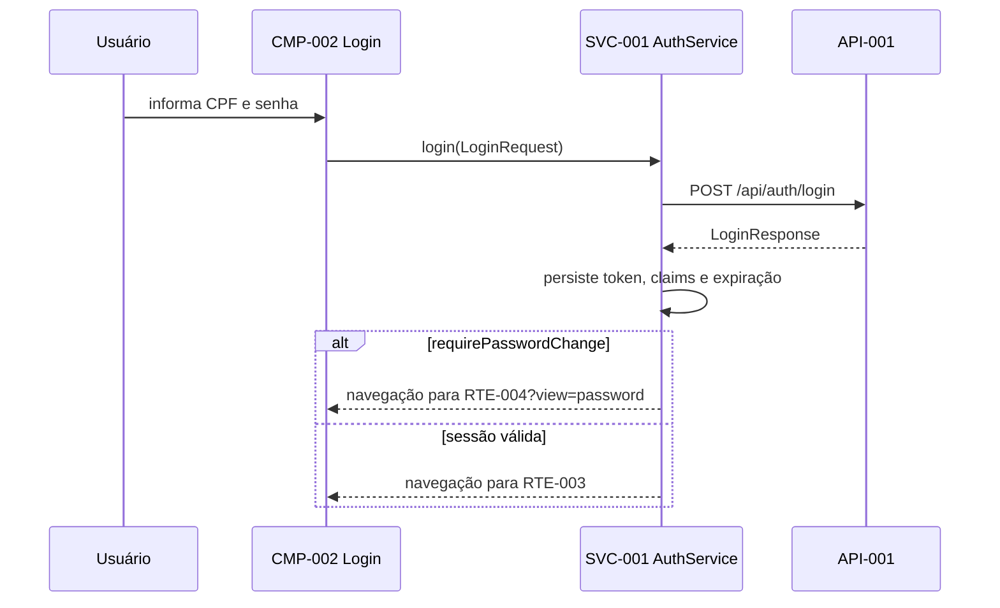

# Documentação Técnica - Sistema Patrimonial Frontend

## 0. Metadados

| Projeto                      | Versão | Angular             | Node    | Gerenciador de pacotes | Última atualização | Mantenedores                      |
| ---------------------------- | ------ | ------------------- | ------- | ---------------------- | ------------------ | --------------------------------- |
| sistema-patrimonial-frontend | 0.0.0  | 21.2.x (CLI 21.2.7) | 20.19.5 | npm 10.8.2             | 2026-09-23         | [PENDENTE: responsáveis técnicos] |

## 1. Introdução

| Item           | Descrição                                                                                                                         |
| -------------- | --------------------------------------------------------------------------------------------------------------------------------- |
| Propósito      | SPA para autenticação, gestão de usuários, perfis, catálogos, bens patrimoniais, perfil próprio e consulta de auditoria.          |
| Escopo         | Interface Angular, RBAC no cliente, formulários reativos, paginação, exportação de relatórios de bens e consumo da API HTTP.      |
| Fora do escopo | Regras de negócio e persistência do backend, OpenAPI, provisionamento de IdP, CDN, observabilidade e infraestrutura automatizada. |
| Público        | Desenvolvedores front-end, QA, arquitetura e operação.                                                                            |

### Glossário

| Termo           | Definição                                                           | ID      |
| --------------- | ------------------------------------------------------------------- | ------- |
| Bem patrimonial | Item inventariado com identificação, estado e vínculos de catálogo. | MOD-008 |
| Catálogo        | Cadastro auxiliar de cor, tipo, status, material ou localização.    | MOD-007 |
| Perfil          | Papel de autorização `COMUM`, `SECRETARIO` ou `ADMINISTRADOR`.      | SVC-001 |
| RBAC            | Controle de acesso por perfil, executado por [GRD-003].             | GRD-003 |
| Sessão          | JWT, claims e expiração persistidos em `localStorage`.              | SVC-001 |
| Página          | Contrato paginado `PageResponse<T>`.                                | MOD-001 |

## 2. Objetivos

| Categoria | Objetivo                                                                     | Requisitos             |
| --------- | ---------------------------------------------------------------------------- | ---------------------- |
| Negócio   | Administrar bens e seus cadastros auxiliares.                                | REQ-F-003, REQ-F-004   |
| Negócio   | Controlar acesso por perfil e registrar consultas de auditoria.              | REQ-F-002, REQ-F-006   |
| UX        | Permitir fluxos de cadastro, edição, busca e paginação em telas responsivas. | REQ-F-003 a REQ-F-006  |
| Técnico   | Consumir API protegida por Bearer token com tratamento de sessão expirada.   | REQ-F-001, REQ-NF-004  |
| Técnico   | Compilar em modo estrito com limite de bundle inicial.                       | REQ-NF-003, REQ-NF-005 |

## 3. Requisitos

### 3.1 Funcionais

| ID        | Descrição                                                                                      | Prioridade | Feature          | Componentes      | Teste            |
| --------- | ---------------------------------------------------------------------------------------------- | ---------- | ---------------- | ---------------- | ---------------- |
| REQ-F-001 | Autenticar com CPF e senha, persistir sessão e exigir troca de senha quando indicada pela API. | Alta       | MOD-003          | CMP-002, CMP-005 | TST-001, TST-002 |
| REQ-F-002 | Restringir rotas autenticadas e autorizadas por perfil.                                        | Alta       | MOD-001          | CMP-003          | TST-003          |
| REQ-F-003 | Listar, filtrar, criar, editar e excluir usuários e perfis.                                    | Alta       | MOD-005, MOD-006 | CMP-006, CMP-007 | TST-004, TST-005 |
| REQ-F-004 | Gerenciar cinco tipos de catálogos auxiliares.                                                 | Alta       | MOD-007          | CMP-008          | TST-006          |
| REQ-F-005 | Pesquisar, cadastrar, editar, excluir e exportar bens patrimoniais.                            | Alta       | MOD-008          | CMP-009          | TST-007          |
| REQ-F-006 | Consultar logs de auditoria com filtros e paginação para administradores.                      | Média      | MOD-010          | CMP-010          | TST-008          |
| REQ-F-007 | Atualizar dados do próprio perfil e alterar senha.                                             | Média      | MOD-004          | CMP-005          | TST-009          |
| REQ-F-008 | Apresentar navegação responsiva e opções filtradas pelo perfil.                                | Média      | MOD-004          | CMP-003, CMP-004 | TST-010          |

### 3.2 Não funcionais

| ID         | Categoria           | Métrica              | Meta                                                     |
| ---------- | ------------------- | -------------------- | -------------------------------------------------------- |
| REQ-NF-001 | Performance         | LCP                  | < 2,5 s [PENDENTE: medição/RUM]                          |
| REQ-NF-002 | Acessibilidade      | WCAG                 | AA [PENDENTE: auditoria axe]                             |
| REQ-NF-003 | Bundle              | Initial JS           | Aviso < 500 kB; erro >= 1 MB                             |
| REQ-NF-004 | Segurança           | Proteção de rota/API | JWT Bearer e RBAC no cliente                             |
| REQ-NF-005 | Qualidade           | Compilação           | TypeScript e templates em modo estrito                   |
| REQ-NF-006 | Internacionalização | Idiomas              | [PENDENTE: definir estratégia Angular i18n ou Transloco] |

### 3.3 Pré-requisitos

| Item                  | Estado                                                                                                         |
| --------------------- | -------------------------------------------------------------------------------------------------------------- |
| Node.js               | 20.19.5, definido em `.nvmrc`.                                                                                 |
| npm                   | 10.8.2, declarado em `package.json`.                                                                           |
| Angular CLI           | 21.2.7 como dependência de desenvolvimento.                                                                    |
| Navegadores           | [PENDENTE: política de navegadores suportados].                                                                |
| API                   | `http://localhost:8080`; URL atualmente fixa em [src/app/core/api.models.ts](src/app/core/api.models.ts#L236). |
| Variáveis de ambiente | [PENDENTE: não há `src/environments` nem substituições de arquivo].                                            |

## 4. Arquitetura

### 4.1 Diagrama de contexto (C4)



### 4.2 Estrutura de pastas

```text
src/app/
├── core/        # contratos HTTP, auth, guards e serviços singleton
├── shared/      # diretivas e utilitários reutilizáveis
├── features/    # auth, layout e páginas de negócio
├── app.config.ts
├── app.routes.ts
└── app.ts
```

| ID      | Área                               | Responsabilidade                                                                                   |
| ------- | ---------------------------------- | -------------------------------------------------------------------------------------------------- |
| MOD-001 | `core`                             | Modelos, autenticação, guardas, interceptor e data access.                                         |
| MOD-002 | `shared`                           | Máscaras e utilitários sem estado global.                                                          |
| MOD-003 | `features/auth`                    | Tela de login.                                                                                     |
| MOD-004 | `features/layout` e perfil próprio | Shell, menu, boas-vindas e perfil.                                                                 |
| MOD-005 | `features/pages/users-page`        | Administração de usuários.                                                                         |
| MOD-006 | `features/pages/profiles-page`     | Administração de perfis.                                                                           |
| MOD-007 | `features/pages/catalog-page`      | Cadastros auxiliares configurados por dados de rota.                                               |
| MOD-008 | `features/pages/assets-page`       | Gestão de bens e exportação de relatórios.                                                         |
| MOD-009 | `features/welcome`                 | [PENDENTE: diretório de feature não contém componente próprio; a página está em `features/pages`]. |
| MOD-010 | `features/pages/audit-logs-page`   | Consulta de auditoria.                                                                             |

### 4.3 Árvore de componentes



### 4.4 Fluxo de dados



### 4.5 Gerenciamento de estado

| Escopo          | Estratégia implementada                                                        | Artefatos         |
| --------------- | ------------------------------------------------------------------------------ | ----------------- |
| Sessão          | Signals no `AuthService` e persistência em `localStorage`.                     | SVC-001           |
| Página          | `signal()` e `computed()` locais, alimentados por `Observable` HTTP.           | CMP-002 a CMP-010 |
| Global dedicado | [PENDENTE: não há NgRx, reducers, effects, store ou `BehaviorSubject` global]. | STO-001           |



### 4.6 Padrões usados

| Padrão                           | Onde              | Motivo                                                         |
| -------------------------------- | ----------------- | -------------------------------------------------------------- |
| Feature/core/shared              | `src/app`         | Separar cross-cutting, reutilização e fluxos de negócio.       |
| Smart page                       | CMP-002 a CMP-010 | As páginas coordenam formulário, navegação, estado e serviços. |
| Serviço singleton                | SVC-001 a SVC-007 | Centralizar chamadas HTTP e autenticação.                      |
| Guard funcional                  | GRD-001 a GRD-003 | Restringir entrada nas rotas.                                  |
| Interceptor funcional            | GRD-004           | Aplicar token e respostas de sessão de maneira transversal.    |
| Componente configurável por rota | CMP-008           | Reusar o CRUD para cinco catálogos.                            |

Não há componentes exclusivamente presentacionais separados das páginas atuais. Essa separação é uma direção de evolução, não comportamento existente.

### 4.7 ADRs

| ID      | Decisão                                                           | Estado            | Evidência                                                                  |
| ------- | ----------------------------------------------------------------- | ----------------- | -------------------------------------------------------------------------- |
| ADR-001 | Usar componentes standalone e `ApplicationConfig`, sem NgModules. | Aceita            | [src/app/app.config.ts](src/app/app.config.ts#L8)                          |
| ADR-002 | Usar signals locais e serviços HTTP, sem store central.           | Aceita            | CMP-002 a CMP-010                                                          |
| ADR-003 | Persistir JWT no `localStorage`.                                  | Aceita            | [src/app/core/auth/auth.service.ts](src/app/core/auth/auth.service.ts#L16) |
| ADR-004 | Fixar a URL base da API no código.                                | Aceita, com risco | [src/app/core/api.models.ts](src/app/core/api.models.ts#L236)              |
| ADR-005 | [PENDENTE: formalizar ADRs versionados em diretório próprio].     | Pendente          | Não há diretório `docs/adr`.                                               |

## 5. Roteamento

| ID      | Path               | Componente           | Lazy          | Guards                                 | Resolvers | Título/Breadcrumb |
| ------- | ------------------ | -------------------- | ------------- | -------------------------------------- | --------- | ----------------- |
| RTE-001 | `/login`           | CMP-002              | Não           | GRD-002                                | Não       | [PENDENTE]        |
| RTE-002 | `/`                | CMP-003              | Não           | GRD-001                                | Não       | [PENDENTE]        |
| RTE-003 | `/welcome`         | CMP-004              | Não           | Herdado de RTE-002                     | Não       | [PENDENTE]        |
| RTE-004 | `/my-profile`      | CMP-005              | Não           | Herdado de RTE-002                     | Não       | [PENDENTE]        |
| RTE-005 | `/users`           | CMP-006              | Não           | GRD-003: `SECRETARIO`, `ADMINISTRADOR` | Não       | [PENDENTE]        |
| RTE-006 | `/profiles`        | CMP-007              | Não           | GRD-003: `ADMINISTRADOR`               | Não       | [PENDENTE]        |
| RTE-007 | `/colors`          | CMP-008              | Não           | GRD-003: todos                         | Não       | Cores             |
| RTE-008 | `/asset-types`     | CMP-008              | Não           | GRD-003: todos                         | Não       | Tipos de bem      |
| RTE-009 | `/asset-statuses`  | CMP-008              | Não           | GRD-003: todos                         | Não       | Status de bem     |
| RTE-010 | `/asset-materials` | CMP-008              | Não           | GRD-003: todos                         | Não       | Materiais         |
| RTE-011 | `/asset-locations` | CMP-008              | Não           | GRD-003: todos                         | Não       | Localizações      |
| RTE-012 | `/assets`          | CMP-009              | Não           | GRD-003: todos                         | Não       | [PENDENTE]        |
| RTE-013 | `/audit-logs`      | CMP-010              | Não           | GRD-003: `ADMINISTRADOR`               | Não       | [PENDENTE]        |
| RTE-014 | `**`               | Redireciona para `/` | Não aplicável | Não                                    | Não       | Não aplicável     |

Todas as rotas estão em [src/app/app.routes.ts](src/app/app.routes.ts#L17); não há carregamento lazy, resolvers, `title` de rota ou breadcrumbs estruturados.

## 6. Componentes

Todos são standalone por padrão no Angular 21. As páginas não declaram `@Input`, `input()`, `@Output` ou `output()` públicos; portanto, não há contratos pai-filho tipados a listar. O conteúdo é entregue por roteamento.

### [CMP-001] App

@ai-tags: feature=app, type=root-component, state=router

| Campo                                       | Valor                                             |
| ------------------------------------------- | ------------------------------------------------- |
| Seletor                                     | `app-root`                                        |
| Responsabilidade                            | Renderizar o `RouterOutlet` raiz.                 |
| Depende de                                  | Angular Router.                                   |
| Ciclo de vida / change detection / projeção | Nenhum hook, estratégia padrão, sem `ng-content`. |
| Acessibilidade                              | Depende das páginas roteadas.                     |
| Uso                                         | Bootstrap em [src/main.ts](src/main.ts#L1).       |

### [CMP-002] LoginPageComponent

@ai-tags: feature=auth, type=smart-component, state=signal

| Campo                                       | Valor                                                       |
| ------------------------------------------- | ----------------------------------------------------------- |
| Seletor                                     | `app-login-page`                                            |
| Responsabilidade                            | Validar credenciais, chamar SVC-001 e navegar após o login. |
| Depende de                                  | SVC-001, DIR-001, `FormBuilder`, `Router`.                  |
| Estado                                      | `loading`, `errorMessage`, `loginForm`.                     |
| Ciclo de vida / change detection / projeção | Sem hook, estratégia padrão, sem projeção.                  |
| Acessibilidade                              | Formulário reativo; [PENDENTE: auditoria WCAG/axe].         |
| Uso                                         | RTE-001 renderiza o componente.                             |

| Tipo        | Nome       | Tipo TS  | Obrigatório | Padrão | Descrição                      |
| ----------- | ---------- | -------- | ----------- | ------ | ------------------------------ |
| FormControl | `cpf`      | `string` | Sim         | vazio  | CPF mascarado antes de enviar. |
| FormControl | `password` | `string` | Sim         | vazio  | Senha de autenticação.         |

### [CMP-003] ShellComponent

@ai-tags: feature=layout, type=smart-component, state=signal

| Campo                                       | Valor                                                                |
| ------------------------------------------- | -------------------------------------------------------------------- |
| Seletor                                     | `app-shell`                                                          |
| Responsabilidade                            | Fornecer sidebar, navegação por perfil e `RouterOutlet` autenticado. |
| Depende de                                  | SVC-001, `Router`, `RouterLink`, `RouterLinkActive`.                 |
| Estado                                      | `menuOpen`, `openSections`, `visibleSections` computado.             |
| Ciclo de vida / change detection / projeção | Observa `NavigationEnd`; estratégia padrão; sem projeção.            |
| Acessibilidade                              | `aria-expanded`, `aria-controls` e `aria-hidden` nos grupos do menu. |
| Uso                                         | RTE-002 contém as rotas autenticadas.                                |

### [CMP-004] WelcomePageComponent

@ai-tags: feature=welcome, type=smart-component, state=signal

| Campo                                       | Valor                                                               |
| ------------------------------------------- | ------------------------------------------------------------------- |
| Seletor                                     | `app-welcome-page`                                                  |
| Responsabilidade                            | Apresentar métricas estáticas e ações rápidas permitidas ao perfil. |
| Depende de                                  | SVC-001.                                                            |
| Estado                                      | `metrics` estático e `quickActions` computado.                      |
| Ciclo de vida / change detection / projeção | Sem hook, estratégia padrão, sem projeção.                          |
| Acessibilidade                              | [PENDENTE: auditoria WCAG/axe].                                     |
| Uso                                         | RTE-003.                                                            |

### [CMP-005] MyProfilePageComponent

@ai-tags: feature=profile, type=smart-component, state=signal

| Campo                                       | Valor                                                                                    |
| ------------------------------------------- | ---------------------------------------------------------------------------------------- |
| Seletor                                     | `app-my-profile-page`                                                                    |
| Responsabilidade                            | Consultar/editar os dados próprios e alterar a senha.                                    |
| Depende de                                  | SVC-001, SVC-007, `FormBuilder`, `ActivatedRoute`, `Router`.                             |
| Estado                                      | `profileData`, `viewMode`, `requiresPasswordChange`, estados de carregamento e mensagem. |
| Ciclo de vida / change detection / projeção | `OnInit` lê query param `view`; estratégia padrão; sem projeção.                         |
| Acessibilidade                              | [PENDENTE: auditoria WCAG/axe].                                                          |
| Uso                                         | RTE-004 e redirecionamento do GRD-004 para `?view=password`.                             |

| Tipo      | Nome           | Tipo TS        | Obrigatório | Padrão       | Descrição                        |
| --------- | -------------- | -------------- | ----------- | ------------ | -------------------------------- |
| FormGroup | `profileForm`  | dados pessoais | Sim         | dados da API | Nome, e-mail e telefone.         |
| FormGroup | `passwordForm` | senhas         | Sim         | vazio        | Senha atual, nova e confirmação. |

### [CMP-006] UsersPageComponent

@ai-tags: feature=users, type=smart-component, state=signal

| Campo                                       | Valor                                                                         |
| ------------------------------------------- | ----------------------------------------------------------------------------- |
| Seletor                                     | `app-users-page`                                                              |
| Responsabilidade                            | Gerir usuários com filtros, paginação e formulário de CRUD.                   |
| Depende de                                  | SVC-002, SVC-003, DIR-001, `FormBuilder`, rota.                               |
| Estado                                      | `users`, `profiles`, `loading`, seleção, modo de visão, paginação e mensagem. |
| Ciclo de vida / change detection / projeção | Sem projeção; estratégia padrão.                                              |
| Acessibilidade                              | Máscara de CPF no campo; [PENDENTE: auditoria WCAG/axe].                      |
| Uso                                         | RTE-005.                                                                      |

| Tipo      | Nome         | Tipo TS       | Obrigatório | Padrão | Descrição                  |
| --------- | ------------ | ------------- | ----------- | ------ | -------------------------- |
| FormGroup | `userForm`   | `UserRequest` | Parcial     | vazio  | Cria ou atualiza usuário.  |
| FormGroup | `filterForm` | `UserFilters` | Não         | vazio  | Filtra nome, CPF e perfil. |

### [CMP-007] ProfilesPageComponent

@ai-tags: feature=profiles, type=smart-component, state=signal

| Campo                                       | Valor                                                        |
| ------------------------------------------- | ------------------------------------------------------------ |
| Seletor                                     | `app-profiles-page`                                          |
| Responsabilidade                            | Gerir perfis de usuário paginados.                           |
| Depende de                                  | SVC-003, `FormBuilder`.                                      |
| Estado                                      | `profiles`, `loading`, seleção, visão, paginação e mensagem. |
| Ciclo de vida / change detection / projeção | Sem projeção; estratégia padrão.                             |
| Acessibilidade                              | [PENDENTE: auditoria WCAG/axe].                              |
| Uso                                         | RTE-006.                                                     |

| Tipo        | Nome      | Tipo TS  | Obrigatório | Padrão | Descrição       |
| ----------- | --------- | -------- | ----------- | ------ | --------------- |
| FormControl | `profile` | `string` | Sim         | vazio  | Nome do perfil. |

### [CMP-008] CatalogPageComponent

@ai-tags: feature=catalogs, type=smart-component, state=signal

| Campo                                       | Valor                                                                                |
| ------------------------------------------- | ------------------------------------------------------------------------------------ |
| Seletor                                     | `app-catalog-page`                                                                   |
| Responsabilidade                            | Reusar o CRUD de catálogos conforme `data` da rota.                                  |
| Depende de                                  | SVC-005, `ActivatedRoute`, `FormBuilder`.                                            |
| Estado                                      | `items`, seleção, filtro, `filteredItems` computado, visão, carregamento e mensagem. |
| Ciclo de vida / change detection / projeção | Sem projeção; estratégia padrão.                                                     |
| Acessibilidade                              | [PENDENTE: auditoria WCAG/axe].                                                      |
| Uso                                         | RTE-007 a RTE-011.                                                                   |

| Tipo        | Nome              | Tipo TS   | Obrigatório | Padrão     | Descrição                                     |
| ----------- | ----------------- | --------- | ----------- | ---------- | --------------------------------------------- |
| Route data  | `CatalogPageData` | interface | Sim         | rota atual | Título, endpoint e obrigatoriedade de código. |
| FormControl | `description`     | `string`  | Sim         | vazio      | Descrição do item.                            |
| FormControl | `code`            | `string`  | Condicional | vazio      | Obrigatório apenas para catálogo codificado.  |

### [CMP-009] AssetsPageComponent

@ai-tags: feature=assets, type=smart-component, state=signal

| Campo                                       | Valor                                                                              |
| ------------------------------------------- | ---------------------------------------------------------------------------------- |
| Seletor                                     | `app-assets-page`                                                                  |
| Responsabilidade                            | Manter bens, carregar lookups e emitir relatórios em Blob.                         |
| Depende de                                  | SVC-004, SVC-005, DIR-002, `FormBuilder`, SVC-001.                                 |
| Estado                                      | `assets`, seleção, modo de visão, catálogos, paginação, prévia da foto e mensagem. |
| Ciclo de vida / change detection / projeção | Sem projeção; estratégia padrão.                                                   |
| Acessibilidade                              | Formulários e controles nativos; [PENDENTE: auditoria WCAG/axe].                   |
| Uso                                         | RTE-012.                                                                           |

| Tipo      | Nome           | Tipo TS          | Obrigatório | Padrão | Descrição                                          |
| --------- | -------------- | ---------------- | ----------- | ------ | -------------------------------------------------- |
| FormGroup | `filterForm`   | `AssetFilters`   | Não         | vazio  | Pesquisa por código, descrição, datas e catálogos. |
| FormGroup | `assetForm`    | `AssetRequest`   | Parcial     | vazio  | Dados e vínculos do bem.                           |
| Signal    | `photoPreview` | `string \| null` | Não         | `null` | Prévia de foto Base64 selecionada.                 |

### [CMP-010] AuditLogsPageComponent

@ai-tags: feature=audit, type=smart-component, state=signal

| Campo                                       | Valor                                                                |
| ------------------------------------------- | -------------------------------------------------------------------- |
| Seletor                                     | `app-audit-logs-page`                                                |
| Responsabilidade                            | Consultar logs de auditoria com filtros e paginação.                 |
| Depende de                                  | SVC-006, DIR-001, `FormBuilder`.                                     |
| Estado                                      | `auditLogs`, paginação, opções de entidade, carregamento e mensagem. |
| Ciclo de vida / change detection / projeção | Sem projeção; estratégia padrão.                                     |
| Acessibilidade                              | Máscara de CPF; [PENDENTE: auditoria WCAG/axe].                      |
| Uso                                         | RTE-013, limitado a administrador.                                   |

| Tipo      | Nome         | Tipo TS           | Obrigatório | Padrão | Descrição                                   |
| --------- | ------------ | ----------------- | ----------- | ------ | ------------------------------------------- |
| FormGroup | `filterForm` | `AuditLogFilters` | Não         | vazio  | Filtra ação, entidade, usuário e intervalo. |

## 7. Serviços, Pipes, Diretivas, Guards e Interceptors

| ID      | Nome                       | Tipo                  | providedIn    | Métodos públicos                                                 | Entrada                 | Saída                                           | Propósito                                 |
| ------- | -------------------------- | --------------------- | ------------- | ---------------------------------------------------------------- | ----------------------- | ----------------------------------------------- | ----------------------------------------- |
| SVC-001 | `AuthService`              | Serviço               | root          | `login`, `logout`, `hasRole`, `hasAnyRole`, `ensureValidSession` | `LoginRequest`          | `Observable<LoginResponse>` e signals           | Sessão JWT e autorização.                 |
| SVC-002 | `UsersApiService`          | Serviço               | root          | `list`, `create`, `update`, `remove`                             | filtros/payload         | `Observable<PageResponse<UserResponse>>` ou DTO | CRUD de usuários.                         |
| SVC-003 | `ProfilesApiService`       | Serviço               | root          | `list`, `listAll`, `create`, `update`, `remove`                  | paginação/payload       | página, lista ou DTO                            | CRUD de perfis.                           |
| SVC-004 | `AssetsApiService`         | Serviço               | root          | `list`, `create`, `update`, `remove`, `downloadReport`           | filtros/payload/formato | página, DTO ou `Blob`                           | CRUD e relatórios de bens.                |
| SVC-005 | `CatalogApiService`        | Serviço               | root          | `list`, `listAll`, `create`, `update`, `remove`                  | endpoint/payload        | página, lista ou DTO                            | CRUD de cinco catálogos.                  |
| SVC-006 | `AuditLogsApiService`      | Serviço               | root          | `list`                                                           | filtros/paginação       | `Observable<PageResponse<AuditLogResponse>>`    | Consulta de logs.                         |
| SVC-007 | `MeApiService`             | Serviço               | root          | `getMyProfile`, `updateMyProfile`, `changePassword`              | payload próprio         | DTO ou `void`                                   | Self-service do usuário autenticado.      |
| PIP-001 | Pipes                      | Pipe                  | Não aplicável | Não aplicável                                                    | Não aplicável           | Não aplicável                                   | [PENDENTE: não há pipes no repositório].  |
| DIR-001 | `CpfMaskDirective`         | Diretiva              | Não aplicável | `ngOnInit`                                                       | valor de `input`        | valor formatado                                 | Formata CPF como `NNN.NNN.NNN-NN`.        |
| DIR-002 | `BrlCurrencyMaskDirective` | Diretiva/CVA          | Não aplicável | `writeValue`, callbacks CVA                                      | número/texto            | valor BRL formatado                             | Integra moeda BRL a formulários reativos. |
| GRD-001 | `authGuard`                | Guard funcional       | Não aplicável | `CanActivateFn`                                                  | rota                    | `boolean \| UrlTree`                            | Exige sessão válida.                      |
| GRD-002 | `guestGuard`               | Guard funcional       | Não aplicável | `CanActivateFn`                                                  | rota                    | `boolean \| UrlTree`                            | Bloqueia login para sessão válida.        |
| GRD-003 | `roleGuard`                | Guard funcional       | Não aplicável | `CanActivateFn`                                                  | `data.roles`            | `boolean \| UrlTree`                            | Exige um dos perfis permitidos.           |
| GRD-004 | `authInterceptor`          | Interceptor funcional | Não aplicável | `HttpInterceptorFn`                                              | `HttpRequest`           | stream HTTP                                     | Injeta Bearer, trata 401 e 428.           |
| SVC-008 | `buildHttpParams`          | Utilitário puro       | Não aplicável | `buildHttpParams`                                                | objeto                  | `HttpParams`                                    | Omite nulos/vazios e preserva zero.       |

Exemplo de TSDoc a adotar para novos métodos. O código existente não contém documentação completa Compodoc/TSDoc.

```ts
/**
 * Lista bens patrimoniais paginados para os filtros informados.
 * @ai-tags feature=assets, layer=data-access
 * @param filters critérios opcionais de busca
 * @param pageRequest paginação opcional
 * @returns Observable que emite a página de bens e completa.
 * @throws HttpErrorResponse propagado pelo HttpClient.
 * @example this.assetsApi.list({ description: 'mesa' }).subscribe();
 * @see API-030, REQ-F-005
 */
list(filters: AssetFilters = {}, pageRequest: PageRequest = {}) {}
```

`@deprecated` não se aplica a APIs públicas atuais; deve ser incluído quando um método ou contrato for descontinuado.

## 8. Modelos e contratos

| Grupo          | Request                                     | Response/UI                                 | Exemplo resumido                                                                                                      |
| -------------- | ------------------------------------------- | ------------------------------------------- | --------------------------------------------------------------------------------------------------------------------- |
| Autenticação   | `LoginRequest`                              | `LoginResponse`, `JwtClaims`                | `{ "cpf": "12345678901", "password": "***" }`                                                                         |
| Usuários       | `UserRequest`, `UserFilters`                | `UserResponse`                              | `{ "id": 1, "name": "Ana", "profile": "ADMINISTRADOR", "active": true }`                                              |
| Perfis         | `UserProfileRequest`                        | `UserProfileResponse`                       | `{ "id": 1, "profile": "ADMINISTRADOR" }`                                                                             |
| Catálogo       | `CatalogRequest` ou `CodedCatalogRequest`   | `CatalogResponse` ou `CodedCatalogResponse` | `{ "id": 1, "description": "Azul", "code": "AZ" }`                                                                    |
| Bens           | `AssetRequest`, `AssetFilters`              | `AssetResponse`                             | `{ "id": 1, "description": "Mesa", "quantity": 2, "assetCode": "PAT-1" }`                                             |
| Perfil próprio | `MyProfileRequest`, `ChangePasswordRequest` | `MyProfileResponse`                         | `{ "name": "Ana", "email": "ana@exemplo.com" }`                                                                       |
| Auditoria      | `AuditLogFilters`                           | `AuditLogResponse`                          | `{ "id": 1, "action": "UPDATE", "entityName": "Asset" }`                                                              |
| Paginação      | `PageRequest`                               | `PageResponse<T>`                           | `{ "items": [], "page": 0, "size": 10, "totalElements": 0, "totalPages": 0, "hasNext": false, "hasPrevious": false }` |

Fonte de verdade dos contratos: [src/app/core/api.models.ts](src/app/core/api.models.ts#L1). Não há mappers dedicados DTO para modelo de UI: os componentes consomem os DTOs de resposta diretamente. `AssetResponse` mantém referências de catálogos para exibição e `AssetRequest` envia seus respectivos IDs.

## 9. Integração com API

Base atual: `http://localhost:8080`. Especificação OpenAPI e URL de ambientes remotos: `[PENDENTE: fornecer]`.

| ID      | Método              | Endpoint                               | Serviço | Request                      | Response                            | Tratamento de erro                           |
| ------- | ------------------- | -------------------------------------- | ------- | ---------------------------- | ----------------------------------- | -------------------------------------------- |
| API-001 | POST                | `/api/auth/login`                      | SVC-001 | `LoginRequest`               | `LoginResponse`                     | CMP-002 diferencia falha de rede, 401 e 5xx. |
| API-002 | GET                 | `/api/users`                           | SVC-002 | filtros/paginação            | `PageResponse<UserResponse>`        | Propagado ao componente.                     |
| API-003 | POST                | `/api/users`                           | SVC-002 | `UserRequest`                | `UserResponse`                      | Propagado ao componente.                     |
| API-004 | PUT                 | `/api/users/{id}`                      | SVC-002 | `UserRequest`                | `UserResponse`                      | Propagado ao componente.                     |
| API-005 | DELETE              | `/api/users/{id}`                      | SVC-002 | Nenhum                       | `void`                              | Propagado ao componente.                     |
| API-006 | GET                 | `/api/profiles`                        | SVC-003 | paginação                    | `PageResponse<UserProfileResponse>` | Propagado ao componente.                     |
| API-007 | POST                | `/api/profiles`                        | SVC-003 | `UserProfileRequest`         | `UserProfileResponse`               | Propagado ao componente.                     |
| API-008 | PUT                 | `/api/profiles/{id}`                   | SVC-003 | `UserProfileRequest`         | `UserProfileResponse`               | Propagado ao componente.                     |
| API-009 | DELETE              | `/api/profiles/{id}`                   | SVC-003 | Nenhum                       | `void`                              | Propagado ao componente.                     |
| API-010 | GET/POST/PUT/DELETE | `/api/colors[/{id}]`                   | SVC-005 | catálogo                     | página/DTO/void                     | Propagado ao componente.                     |
| API-011 | GET/POST/PUT/DELETE | `/api/asset-types[/{id}]`              | SVC-005 | catálogo codificado          | página/DTO/void                     | Propagado ao componente.                     |
| API-012 | GET/POST/PUT/DELETE | `/api/asset-statuses[/{id}]`           | SVC-005 | catálogo                     | página/DTO/void                     | Propagado ao componente.                     |
| API-013 | GET/POST/PUT/DELETE | `/api/asset-materials[/{id}]`          | SVC-005 | catálogo                     | página/DTO/void                     | Propagado ao componente.                     |
| API-014 | GET/POST/PUT/DELETE | `/api/asset-locations[/{id}]`          | SVC-005 | catálogo codificado          | página/DTO/void                     | Propagado ao componente.                     |
| API-015 | GET                 | `/api/assets`                          | SVC-004 | `AssetFilters`, paginação    | `PageResponse<AssetResponse>`       | Propagado ao componente.                     |
| API-016 | POST                | `/api/assets`                          | SVC-004 | `AssetRequest`               | `AssetResponse`                     | Propagado ao componente.                     |
| API-017 | PUT                 | `/api/assets/{id}`                     | SVC-004 | `AssetRequest`               | `AssetResponse`                     | Propagado ao componente.                     |
| API-018 | DELETE              | `/api/assets/{id}`                     | SVC-004 | Nenhum                       | `void`                              | Propagado ao componente.                     |
| API-019 | GET                 | `/api/assets/report/{csv\|excel\|pdf}` | SVC-004 | formato                      | `Blob`                              | Propagado ao componente.                     |
| API-020 | GET                 | `/api/me`                              | SVC-007 | Nenhum                       | `MyProfileResponse`                 | Propagado ao componente.                     |
| API-021 | PUT                 | `/api/me`                              | SVC-007 | `MyProfileRequest`           | `MyProfileResponse`                 | Propagado ao componente.                     |
| API-022 | PUT                 | `/api/me/password`                     | SVC-007 | `ChangePasswordRequest`      | `void`                              | Logout após sucesso; erro propagado.         |
| API-023 | GET                 | `/api/audit-logs`                      | SVC-006 | `AuditLogFilters`, paginação | `PageResponse<AuditLogResponse>`    | Propagado ao componente.                     |

### Interceptors, cache e client

| Aspecto                   | Implementação                                                     |
| ------------------------- | ----------------------------------------------------------------- |
| Autorização               | GRD-004 inclui `Authorization: Bearer <token>` quando há token.   |
| 401                       | GRD-004 encerra a sessão e navega para `/login`, exceto no login. |
| 428                       | GRD-004 redireciona para `/my-profile?view=password`.             |
| Retry/loading/erro global | [PENDENTE: não implementados].                                    |
| Cache                     | [PENDENTE: não há cache HTTP/store configurado].                  |
| Geração OpenAPI           | [PENDENTE: não configurada].                                      |



Checkout não é funcionalidade presente no repositório; diagrama correspondente: `[PENDENTE: fluxo inexistente]`.

## 10. Funcionalidades

| Funcionalidade | Requisitos           | Rotas             | Componentes      | Serviços         | Estado                   |
| -------------- | -------------------- | ----------------- | ---------------- | ---------------- | ------------------------ |
| Acesso         | REQ-F-001, REQ-F-002 | RTE-001 a RTE-002 | CMP-002, CMP-003 | SVC-001          | Signals de sessão.       |
| Perfil próprio | REQ-F-007            | RTE-004           | CMP-005          | SVC-001, SVC-007 | Signals locais.          |
| Usuários       | REQ-F-003            | RTE-005           | CMP-006          | SVC-002, SVC-003 | Signals locais.          |
| Perfis         | REQ-F-003            | RTE-006           | CMP-007          | SVC-003          | Signals locais.          |
| Catálogos      | REQ-F-004            | RTE-007 a RTE-011 | CMP-008          | SVC-005          | Signals locais/computed. |
| Bens           | REQ-F-005            | RTE-012           | CMP-009          | SVC-004, SVC-005 | Signals locais.          |
| Auditoria      | REQ-F-006            | RTE-013           | CMP-010          | SVC-006          | Signals locais.          |

## 11. UI/UX

| Item                 | Estado                                                                                                                   |
| -------------------- | ------------------------------------------------------------------------------------------------------------------------ |
| Design system/tema   | CSS próprio em `src/styles.css` e estilos de componentes; [PENDENTE: tokens formais/documentados].                       |
| Biblioteca visual    | Não há Angular Material ou biblioteca equivalente nas dependências.                                                      |
| Responsividade       | Shell tem comportamento móvel, `dvh`, área segura e alvos de toque ampliados conforme histórico do repositório.          |
| Breakpoints          | [PENDENTE: consolidar valores e tokens em documentação de design].                                                       |
| i18n                 | Textos estão em português e não há Angular i18n/Transloco configurado.                                                   |
| Moeda/CPF            | DIR-002 usa `pt-BR`/BRL; DIR-001 formata CPF.                                                                            |
| Acessibilidade atual | Menu possui atributos ARIA; formulários usam controles nativos.                                                          |
| Checklist WCAG AA    | [PENDENTE: validar contraste, foco visível, ordem de tabulação, mensagens de erro, nomes acessíveis e axe automatizado]. |

## 12. Configuração e Deployment

| ID      | Chave                      | Arquivo         | dev                     | hml          | prod                     | Descrição                                       |
| ------- | -------------------------- | --------------- | ----------------------- | ------------ | ------------------------ | ----------------------------------------------- |
| CFG-001 | `API_BASE_URL`             | `api.models.ts` | `http://localhost:8080` | [PENDENTE]   | [PENDENTE]               | URL fixa no código.                             |
| CFG-002 | `initial` budget           | `angular.json`  | Não definido            | Não definido | 500 kB aviso / 1 MB erro | Limite de bundle inicial.                       |
| CFG-003 | `anyComponentStyle` budget | `angular.json`  | Não definido            | Não definido | 4 kB aviso / 8 kB erro   | Limite por estilo de componente.                |
| CFG-004 | `optimization`             | `angular.json`  | `false`                 | [PENDENTE]   | padrão do builder        | Otimização explícita apenas em desenvolvimento. |
| CFG-005 | `outputHashing`            | `angular.json`  | [PENDENTE]              | [PENDENTE]   | `all`                    | Hash de assets no build de produção.            |

| Tópico            | Estado                                                                                                               |
| ----------------- | -------------------------------------------------------------------------------------------------------------------- |
| `angular.json`    | Builder `@angular/build:application`; `src/main.ts`, `src/styles.css` e `public/**`.                                 |
| `tsconfig`        | `strict`, `strictTemplates` e `strictInjectionParameters` ativos.                                                    |
| Environment/proxy | [PENDENTE: não há `environment.*` nem proxy configurado].                                                            |
| Build             | `npm run build` ou `ng build --configuration production`.                                                            |
| SSR/prerender     | [PENDENTE: não configurados].                                                                                        |
| Dockerfile/Nginx  | [PENDENTE: não versionados]. O guia existente indica Nginx em Oracle Cloud, sem artefatos de runtime no repositório. |
| CDN/cache headers | [PENDENTE: definir].                                                                                                 |
| CI/CD             | [PENDENTE: não há pipeline]. Sequência recomendada: lint -> test -> build -> e2e -> deploy.                          |
| Monitoramento     | `provideBrowserGlobalErrorListeners()` existe; Sentry, Web Vitals e analytics são [PENDENTE].                        |

O guia manual disponível está em [DEPLOY_ORACLE_CLOUD.md](DEPLOY_ORACLE_CLOUD.md).

## 13. Dependências

| Pacote                                                                       | Versão declarada | Tipo | Propósito                               | Licença    |
| ---------------------------------------------------------------------------- | ---------------- | ---- | --------------------------------------- | ---------- |
| `@angular/common`, `compiler`, `core`, `forms`, `platform-browser`, `router` | `^21.2.0`        | dep  | Framework, forms, browser e roteamento. | MIT        |
| `rxjs`                                                                       | `~7.8.0`         | dep  | Streams e HTTP observáveis.             | Apache-2.0 |
| `tslib`                                                                      | `^2.3.0`         | dep  | Helpers TypeScript.                     | 0BSD       |
| `@angular/build`, `@angular/cli`, `@angular/compiler-cli`                    | `^21.2.x`        | dev  | Build, CLI e compilação Angular.        | MIT        |
| `typescript`                                                                 | `~5.9.2`         | dev  | Linguagem e verificação estática.       | Apache-2.0 |
| `vitest`                                                                     | `^4.0.8`         | dev  | Runner de testes unitários.             | MIT        |
| `jsdom`                                                                      | `^28.0.0`        | dev  | DOM para testes.                        | MIT        |
| `prettier`                                                                   | `^3.8.1`         | dev  | Formatação.                             | MIT        |

Licenças devem ser confirmadas no lockfile/SBOM no pipeline: `[PENDENTE: automação de auditoria de dependências]`.

## 14. Testes

| Nível                       | Implementado                                                                             | Ferramentas                                           | Situação                   |
| --------------------------- | ---------------------------------------------------------------------------------------- | ----------------------------------------------------- | -------------------------- |
| Unitário                    | Serviços, guards, interceptor, diretiva CPF, utilitários e componentes raiz/login/shell. | Vitest, TestBed, `HttpTestingController`, `vi.spyOn`. | Implementado.              |
| Integração de componentes   | Parcial, via TestBed.                                                                    | Angular TestBed.                                      | Implementado parcialmente. |
| E2E                         | Não.                                                                                     | Cypress/Playwright.                                   | [PENDENTE].                |
| Visual                      | Não.                                                                                     | [PENDENTE].                                           | [PENDENTE].                |
| Acessibilidade automatizada | Não.                                                                                     | axe.                                                  | [PENDENTE].                |

| ID      | Tipo          | Requisito | Cenário Given/When/Then                                                                    | Esperado                              |
| ------- | ------------- | --------- | ------------------------------------------------------------------------------------------ | ------------------------------------- |
| TST-001 | Unitário      | REQ-F-001 | Dado login válido, quando a API responde token, então persiste a sessão.                   | Signals e `localStorage` atualizados. |
| TST-002 | Componente    | REQ-F-001 | Dado formulário inválido, quando submete, então não chama login.                           | Erro/validação apresentada.           |
| TST-003 | Unitário      | REQ-F-002 | Dado perfil ausente ou não permitido, quando acessa rota, então guard redireciona.         | `UrlTree` correto.                    |
| TST-004 | HTTP unitário | REQ-F-003 | Dado filtro/paginação, quando lista usuários, então constrói query.                        | Request e resposta tipadas.           |
| TST-005 | HTTP unitário | REQ-F-003 | Dado payload de perfil, quando cria/edita/remove, então usa verbo/URL corretos.            | CRUD esperado.                        |
| TST-006 | HTTP unitário | REQ-F-004 | Dado endpoint de catálogo, quando executa CRUD/listAll, então usa o endpoint informado.    | Resposta e páginas agregadas.         |
| TST-007 | HTTP unitário | REQ-F-005 | Dado bem e formato de relatório, quando chama serviço, então usa endpoint e Blob corretos. | CRUD/relatório esperado.              |
| TST-008 | HTTP unitário | REQ-F-006 | Dado filtro de auditoria, quando lista, então serializa query.                             | Página de logs esperada.              |
| TST-009 | [PENDENTE]    | REQ-F-007 | Dado troca de senha, quando API confirma, então sessão é encerrada.                        | Criar teste de CMP-005/SVC-007.       |
| TST-010 | Componente    | REQ-F-008 | Dado perfil, quando shell renderiza/navega, então menu visível respeita papel.             | Seções corretas e menu fecha.         |

Comandos disponíveis:

```bash
npm test
npm run build
```

`npx playwright test`, coverage mínima e MSW não estão configurados: `[PENDENTE]`. Os mocks HTTP existentes usam `HttpTestingController`; os de colaboração usam `vi.spyOn`. A cobertura numérica e seus thresholds não são definidos no projeto.

Em 2026-09-23, `npm test` não iniciou os cenários porque [src/app/core/auth/auth.service.spec.ts](src/app/core/auth/auth.service.spec.ts#L29) e [src/app/core/auth/auth.service.spec.ts](src/app/core/auth/auth.service.spec.ts#L163) tipam fixtures de `LoginResponse` sem `refreshToken`, `refreshExpiresInSeconds` e `requirePasswordChange`. Corrigir esses fixtures é necessário para validar TST-001 a TST-010 pela suíte atual.

Exemplos mínimos de padrão já usado no repositório:

```ts
// Serviço: intercepta a URL e devolve a resposta simulada.
service.list().subscribe((page) => expect(page.items).toEqual([]));
const request = httpMock.expectOne(`${API_BASE_URL}/api/users`);
request.flush({
  items: [],
  page: 0,
  size: 10,
  totalElements: 0,
  totalPages: 0,
  hasNext: false,
  hasPrevious: false,
});

// Componente: valida o formulário antes de acionar o serviço.
component.submit();
expect(authService.login).not.toHaveBeenCalled();
```

## 15. Guias

### Instalação

```bash
nvm use
npm ci
npm start
```

A aplicação de desenvolvimento é atendida em `http://localhost:4200/`. A API local precisa estar disponível em `http://localhost:8080` enquanto CFG-001 permanecer fixo.

### Uso da aplicação

| Fluxo     | Passos                                                                                  |
| --------- | --------------------------------------------------------------------------------------- |
| Login     | Acessar RTE-001, informar CPF e senha; seguir para RTE-003 ou RTE-004 conforme retorno. |
| Gestão    | Usar o menu do CMP-003; as opções respeitam GRD-003.                                    |
| Bens      | Abrir RTE-012, aplicar filtros, cadastrar/editar e escolher um relatório.               |
| Auditoria | Um `ADMINISTRADOR` abre RTE-013 e filtra os eventos.                                    |

### Criar uma nova feature

1. Criar `src/app/features/<nome>/` e manter nomes `feature.type.ts`.
2. Gerar o componente standalone: `ng generate component features/<nome>/<nome>-page --standalone`.
3. Gerar serviço de acesso a dados em `core/services` quando o contrato for transversal: `ng generate service core/services/<nome>-api`.
4. Declarar tipos de request/response em `api.models.ts` ou, após ADR, na feature correspondente.
5. Adicionar rota lazy quando possível, guardas e IDs `MOD-*`, `CMP-*`, `SVC-*`, `RTE-*`, `API-*` e `TST-*` nesta documentação.
6. Criar o `.spec.ts`, executar `npm test` e `npm run build`.
7. Documentar TSDoc completo em APIs públicas e a decisão arquitetural quando afetar estrutura/segurança.

### Onboarding e contribuição

Ordem de leitura: `package.json` -> `app.config.ts` -> `app.routes.ts` -> `core/api.models.ts` -> serviço/página da feature.

| Tema             | Estado                                                           |
| ---------------- | ---------------------------------------------------------------- |
| Formatação       | Prettier: largura 100, aspas simples e parser Angular para HTML. |
| Lint             | [PENDENTE: instalar/configurar `angular-eslint`].                |
| Commits          | [PENDENTE: adotar Conventional Commits e validação no CI].       |
| Versionamento    | [PENDENTE: política SemVer; versão atual é `0.0.0`].             |
| Branch/PR/review | [PENDENTE: documentar em `CONTRIBUTING.md`].                     |

## 16. Notas técnicas

| Tema           | Situação e ação                                                                                                                                                                                     |
| -------------- | --------------------------------------------------------------------------------------------------------------------------------------------------------------------------------------------------- |
| Performance    | Há budget de produção. `OnPush`, `@defer`, lazy loading e análise de bundle não estão implementados. Aplicar após medir impacto.                                                                    |
| Segurança      | Token é armazenado em `localStorage`; avaliar risco de XSS, CSP e alternativa baseada em cookie HttpOnly com o backend. Não há refresh automático apesar de `LoginResponse` retornar refresh token. |
| Sanitização    | Angular fornece sanitização de template; validar URLs/Base64 e não burlar `DomSanitizer`.                                                                                                           |
| CSRF           | [PENDENTE: confirmar mecanismo do backend, especialmente se migrar para cookies].                                                                                                                   |
| Memory leaks   | [PENDENTE: revisar subscriptions manuais e adotar `takeUntilDestroyed`/`async` quando aplicável].                                                                                                   |
| Dívida técnica | URL de API fixa, contratos centralizados em um arquivo, ausência de i18n, lint, E2E, CI, cache e observabilidade.                                                                                   |
| Roadmap        | Formalizar ADRs, configurar ambientes/CI/lint/i18n, adotar lazy loading/OnPush após testes, e adicionar testes E2E/axe.                                                                             |

| Sintoma                             | Causa                                                | Solução                                                       |
| ----------------------------------- | ---------------------------------------------------- | ------------------------------------------------------------- |
| API não responde no desenvolvimento | API local não está em `localhost:8080`.              | Iniciar backend ou parametrizar CFG-001.                      |
| Navegação volta ao login            | Token expirou, é inválido, ou servidor retornou 401. | Autenticar novamente; investigar expiração e resposta da API. |
| Redirecionamento ao perfil próprio  | Servidor retornou 428 ou `requirePasswordChange`.    | Alterar senha em RTE-004.                                     |
| `ng e2e` falha                      | Nenhum runner E2E configurado.                       | Configurar Cypress ou Playwright.                             |
| Não há comando de lint              | `angular-eslint` não está instalado.                 | Configurar ESLint e script de lint.                           |

## 17. Índice de referências cruzadas

| ID      | Tipo           | Arquivo:linha                                                                                                            | Relacionados                        |
| ------- | -------------- | ------------------------------------------------------------------------------------------------------------------------ | ----------------------------------- |
| CMP-001 | Componente     | [src/app/app.ts](src/app/app.ts#L4)                                                                                      | RTE-001 a RTE-014                   |
| CMP-002 | Componente     | [src/app/features/auth/login-page.component.ts](src/app/features/auth/login-page.component.ts#L13)                       | RTE-001, SVC-001, DIR-001, TST-002  |
| CMP-003 | Componente     | [src/app/features/layout/shell.component.ts](src/app/features/layout/shell.component.ts#L95)                             | RTE-002, SVC-001, TST-010           |
| CMP-004 | Componente     | [src/app/features/pages/welcome-page.component.ts](src/app/features/pages/welcome-page.component.ts#L7)                  | RTE-003, SVC-001                    |
| CMP-005 | Componente     | [src/app/features/pages/my-profile-page.component.ts](src/app/features/pages/my-profile-page.component.ts#L13)           | RTE-004, SVC-007, GRD-004           |
| CMP-006 | Componente     | [src/app/features/pages/users-page.component.ts](src/app/features/pages/users-page.component.ts#L15)                     | RTE-005, SVC-002, SVC-003           |
| CMP-007 | Componente     | [src/app/features/pages/profiles-page.component.ts](src/app/features/pages/profiles-page.component.ts#L12)               | RTE-006, SVC-003                    |
| CMP-008 | Componente     | [src/app/features/pages/catalog-page.component.ts](src/app/features/pages/catalog-page.component.ts#L20)                 | RTE-007 a RTE-011, SVC-005          |
| CMP-009 | Componente     | [src/app/features/pages/assets-page.component.ts](src/app/features/pages/assets-page.component.ts#L24)                   | RTE-012, SVC-004, SVC-005, DIR-002  |
| CMP-010 | Componente     | [src/app/features/pages/audit-logs-page.component.ts](src/app/features/pages/audit-logs-page.component.ts#L17)           | RTE-013, SVC-006, DIR-001           |
| SVC-001 | Serviço        | [src/app/core/auth/auth.service.ts](src/app/core/auth/auth.service.ts#L13)                                               | API-001, GRD-001 a GRD-004          |
| SVC-002 | Serviço        | [src/app/core/services/users-api.service.ts](src/app/core/services/users-api.service.ts#L7)                              | API-002 a API-005, CMP-006          |
| SVC-003 | Serviço        | [src/app/core/services/profiles-api.service.ts](src/app/core/services/profiles-api.service.ts#L14)                       | API-006 a API-009, CMP-006, CMP-007 |
| SVC-004 | Serviço        | [src/app/core/services/assets-api.service.ts](src/app/core/services/assets-api.service.ts#L14)                           | API-015 a API-019, CMP-009          |
| SVC-005 | Serviço        | [src/app/core/services/catalog-api.service.ts](src/app/core/services/catalog-api.service.ts#L19)                         | API-010 a API-014, CMP-008, CMP-009 |
| SVC-006 | Serviço        | [src/app/core/services/audit-logs-api.service.ts](src/app/core/services/audit-logs-api.service.ts#L13)                   | API-023, CMP-010                    |
| SVC-007 | Serviço        | [src/app/core/services/me-api.service.ts](src/app/core/services/me-api.service.ts#L6)                                    | API-020 a API-022, CMP-005          |
| DIR-001 | Diretiva       | [src/app/shared/directives/cpf-mask.directive.ts](src/app/shared/directives/cpf-mask.directive.ts#L7)                    | CMP-002, CMP-006, CMP-010           |
| DIR-002 | Diretiva       | [src/app/shared/directives/brl-currency-mask.directive.ts](src/app/shared/directives/brl-currency-mask.directive.ts#L19) | CMP-009                             |
| GRD-001 | Guard          | [src/app/core/guards/auth.guard.ts](src/app/core/guards/auth.guard.ts#L6)                                                | RTE-002                             |
| GRD-002 | Guard          | [src/app/core/guards/guest.guard.ts](src/app/core/guards/guest.guard.ts#L6)                                              | RTE-001                             |
| GRD-003 | Guard          | [src/app/core/guards/role.guard.ts](src/app/core/guards/role.guard.ts#L7)                                                | RTE-005 a RTE-013                   |
| GRD-004 | Interceptor    | [src/app/core/auth/auth.interceptor.ts](src/app/core/auth/auth.interceptor.ts#L8)                                        | SVC-001, API-001 a API-023          |
| MOD-001 | Contratos/core | [src/app/core/api.models.ts](src/app/core/api.models.ts#L1)                                                              | SVC-001 a SVC-007                   |
| RTE-001 | Rota           | [src/app/app.routes.ts](src/app/app.routes.ts#L17)                                                                       | CMP-002, GRD-002                    |
| STO-001 | Estado         | [PENDENTE: não existe arquivo de store]                                                                                  | CMP-002 a CMP-010                   |

## Critérios de qualidade

| Critério                                        | Situação                                                                                                      |
| ----------------------------------------------- | ------------------------------------------------------------------------------------------------------------- |
| Componentes, serviços, rotas e endpoints têm ID | Atendido: CMP-001 a CMP-010, SVC-001 a SVC-008, RTE-001 a RTE-014, API-001 a API-023.                         |
| Inputs e outputs tipados com exemplo            | Não se aplica aos componentes de produção atuais: não expõem inputs/outputs.                                  |
| Requisitos ligados a componente e teste         | Atendido nas tabelas 3.1 e 14; TST-009 é pendência de cobertura.                                              |
| Mermaid válido e sem duplicação                 | Diagramas de contexto, árvore, estado, dados e login incluídos.                                               |
| Nomenclatura/Angular Style Guide                | Existente: `feature.type.ts`; melhorias de OnPush, `input`/`output`, lazy routes e lint permanecem pendentes. |
| Nova feature a partir da seção 15               | Atendido, condicionado às pendências de lint/CI/ADR indicadas.                                                |
